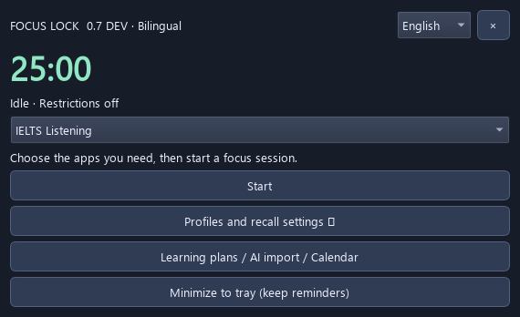
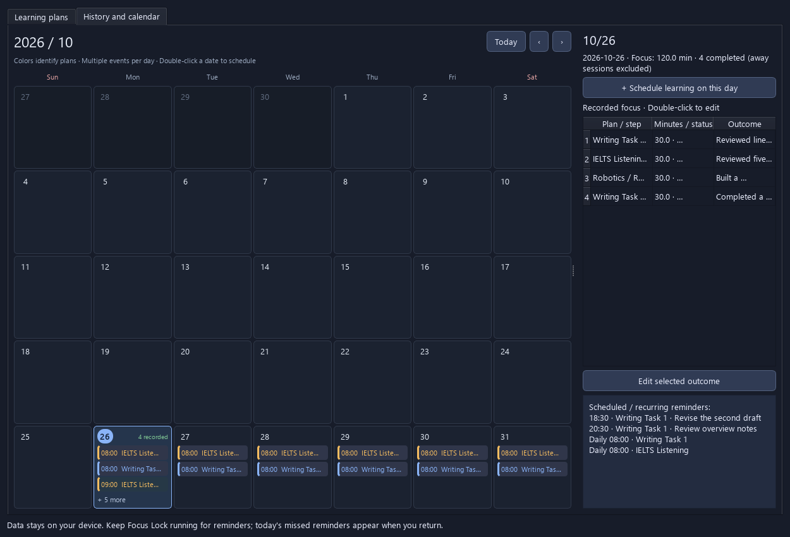

# Focus Lock

[繁體中文](README.zh-TW.md) · **English**

A local-first Windows 11 focus timer that helps you choose your tools, finish a learning session, and recall what you learned.

**Status:** early development release, Python 3.12 + PySide6. This is a personal focus aid, not an operating-system security boundary.



## Start simple

1. Choose a profile and its allowed applications.
2. Start a focus session. Only a small always-on-top timer stays visible; hover for controls.
3. Record your outcome when the timer ends.

Profile management and active recall settings are collapsed by default. Learning plans, scheduling and the calendar are optional.

## Features

- Monotonic-clock countdown, custom focus/break durations, dark theme, opacity and tray controls.
- App allowlists/blocklists using foreground-window detection and screen covers; background work is never terminated.
- Optional Chrome/Edge extension for precise URL allowlists. Existing disallowed pages receive an interaction cover; new navigation is restricted.
- Multi-step learning plans with fixed durations, reusable templates and a preview-only AI JSON import. No AI API is connected.
- Immediate outcome cards: continue, move to the next step, practice, review or schedule another session.
- Local month calendar with multiple events per day, daily/one-time reminders and editable outcome notes.
- Optional active recall: set a question and success criterion before studying, then explain a key idea, an example and anything unclear. Pending recall checks block the next session inside this version of the app, even after restart.
- Traditional Chinese and English desktop UI. Select **Language** in the main window and restart. Your own plan names, notes, paths and URLs are never translated. The browser extension follows the browser's UI language.



## Run from source

Use 64-bit **Python 3.12** on Windows 11:

```powershell
py -3.12 -m venv .venv
.\.venv\Scripts\python.exe -m pip install -r requirements.txt
.\.venv\Scripts\python.exe main.py
```

For packaged builds, see [Releases](https://github.com/tinawu0901/focus-lock/releases). Unzip the complete release folder, keep its files together, then open `FocusLock.exe`. Close the previous instance from its tray menu before switching versions. Windows may display a warning because the early EXE is unsigned.

App restrictions work without the browser extension. For website restrictions, follow [browser setup](BROWSER_SETUP.en.md).

## Test and build

```powershell
.\.venv\Scripts\python.exe -m unittest discover -s tests -v
node --test tests/test_extension.cjs tests/test_extension_background.cjs tests/test_extension_i18n.cjs
.\.venv\Scripts\python.exe -m PyInstaller --noconfirm FocusLock.spec
.\.venv\Scripts\python.exe -m PyInstaller --noconfirm BrowserHost.spec
```

The build produces `dist\FocusLock.exe` and `dist\FocusLockBrowserHost.exe`. `build.ps1` also installs requirements, runs Python tests and builds both EXEs. A pinned development environment is recorded in `requirements-lock.txt`; `requirements.txt` is the normal installation entry point.

For an isolated EXE startup check:

```powershell
.\dist\FocusLock.exe --smoke-test verification\smoke
```

Tests use temporary storage and offscreen Qt widgets; they do not enforce restrictions against your working windows. `preview.py --english` generates screenshots from fictional sample data.

## Data and limitations

All application data lives in `%LOCALAPPDATA%\FocusLock`: `settings.json`, `learning.json`, local browser-bridge policy/status files and emergency-unlock events. No cloud account, telemetry or server is required. The Git repository excludes these files. AI prompts leave the app only if you choose to copy them into another service.

Keep the app running in the tray for reminders. It cannot wake a sleeping computer or notify while closed. Pending one-time reminders remain; daily reminders catch up for the current day, not every missed historical day. Progress is checkpointed about every five seconds; restart retains an interrupted record without counting offline time or automatically restoring restrictions.

Application restrictions are foreground covers, not process termination, global input locking or a tamper-proof kiosk. Secure desktop, elevated windows, browser profiles/incognito, embedded browsers and browser-internal pages have limitations. Do not assume every browser profile is protected. Allowed pages may load their normal supporting resources; this is not network isolation. No proxy, firewall, hosts file, corporate policy or security-software settings are modified. Emergency unlock remains available.

Away-from-laptop sessions are excluded from learning totals. Active recall is a self-check, not an assessment of mastery. Break time continues while you reflect; automatic four-hour timetable allocation, cloud ranking and mobile synchronization are not implemented.

## Repository map

`focus_lock/core.py` provides timing and app policy; `ui.py`, `guard.py` and `compact.py` provide the desktop UI; `learning*.py`, `recall.py` and `calendar_ui.py` provide learning workflows; `i18n.py` and `translations.py` provide UI localization. `browser-extension/` and the native host provide local website enforcement. `tests/` covers timing, persistence, workflow, URL rules and localization.

## License

No open-source license has been selected yet. A public repository does not by itself grant a general reuse license. Third-party packages retain their own licenses.
