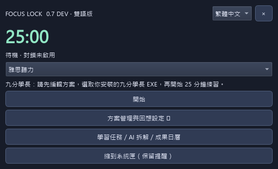
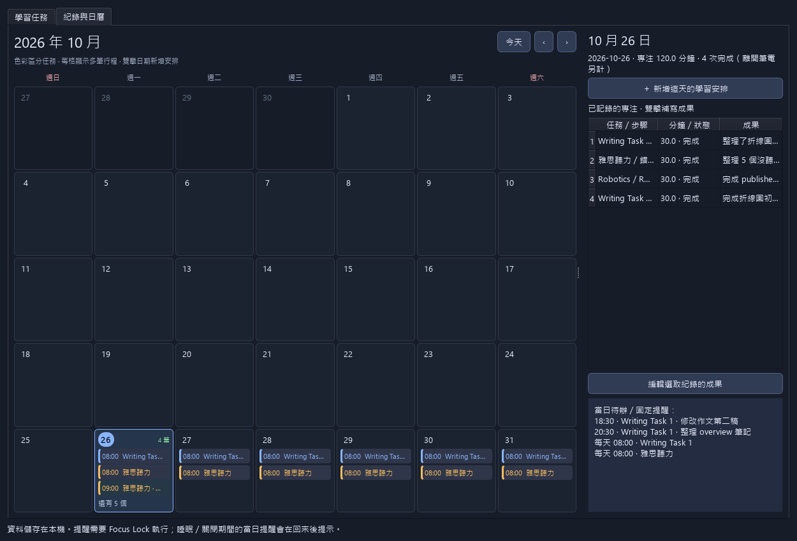

# Focus Lock

**繁體中文** · [English](README.md)

Windows 11 本機專注工具：選好工作工具、完成學習，再用回想確認自己吸收了什麼。

目前為開發版本，使用 Python 3.12 + PySide6。這是個人專注輔助工具，不是作業系統安全隔離機制。



## 先從簡單開始

1. 選方案並設定允許的應用程式。
2. 開始後只保留頂端小計時器，滑鼠移過去才顯示控制。
3. 結束時記下成果。

方案管理與回想設定預設收合。多步驟任務、日曆、提醒與回想模式均可自行選用。

## 功能

- monotonic clock 倒數、自訂專注與休息時間、深色介面、透明度、系統匣。
- 程式白名單／黑名單與前景視窗遮罩，不終止背景程式或未儲存文件。
- Chrome／Edge 擴充功能精準允許網址；既有非允許頁面加遮罩，新導覽套用限制。
- 多步驟任務、固定時長、Writing／聽力範本，以及 AI JSON 匯入預覽；未串接 AI API。
- 結束立即出現成果卡，可繼續、下一步、回頭補強、實作或安排下次時間。
- 一天可放多筆任務的月曆、每日／單次提醒、成果筆記。
- 選用回想檢查：開始前訂問題與完成標準，結束後填重點、例子與卡點。待補回想會保留至重啟，完成後才允許本版開始下一段。
- 繁體中文／English 切換：主畫面選語言後重新啟動。自己的任務、筆記、路徑、網址保留原文；擴充功能依瀏覽器語言顯示。



## 啟動

Windows 11 安裝 64 位元 Python 3.12：

```powershell
py -3.12 -m venv .venv
.\.venv\Scripts\python.exe -m pip install -r requirements.txt
.\.venv\Scripts\python.exe main.py
```

EXE 請至 [Releases](https://github.com/tinawu0901/focus-lock/releases) 下載並完整解壓縮，保留資料夾內所有檔案，開啟 `FocusLock.exe`。切換版本前從舊版系統匣退出；開發版未簽章，Windows 可能顯示提醒。

程式限制不需要擴充功能；網址限制請依 [瀏覽器安裝說明](BROWSER_SETUP.md) 設定。

## 測試與打包

```powershell
.\.venv\Scripts\python.exe -m unittest discover -s tests -v
node --test tests/test_extension.cjs tests/test_extension_background.cjs tests/test_extension_i18n.cjs
.\.venv\Scripts\python.exe -m PyInstaller --noconfirm FocusLock.spec
.\.venv\Scripts\python.exe -m PyInstaller --noconfirm BrowserHost.spec
```

結果為 `dist\FocusLock.exe` 與 `dist\FocusLockBrowserHost.exe`。`build.ps1` 可安裝依賴、執行 Python 測試並打包兩個 EXE。測試與 `preview.py` 使用暫存／示例資料，不操作真實工作視窗。

## 資料與限制

所有資料留在 `%LOCALAPPDATA%\FocusLock`：設定、學習紀錄、本機橋接狀態與緊急解鎖事件；Git 不包含這些資料。不需雲端帳號、遙測或伺服器。只有自行把提示詞貼到外部 AI 時，內容才會送至該服務。

提醒需要程式持續執行，可縮到系統匣；不會喚醒電腦，也不會在退出後通知。單次待辦保留，每日提醒只補當日。每約五秒保存進度，重啟保留中斷紀錄，不把離線時間算入，也不自動恢復封鎖。

限制使用前景遮罩，不是完全鎖機或防竄改機制。安全桌面、較高權限視窗、未安裝擴充功能的瀏覽器個人資料／無痕模式、內嵌瀏覽器及瀏覽器內建頁面均有限制。允許頁面可載入必要資源，並非全面網路隔離。不修改代理、hosts、防火牆、公司網路政策或安全軟體；緊急解鎖保留。

離開筆電時間不計入學習總分鐘；回想只做自我檢查，不代表已經學會。回想期間休息倒數照常進行。四小時課表自動分配、雲端排名與手機同步尚未實作。

## 授權

目前尚未選擇開源授權。公開原始碼不等於授予一般重用授權；第三方套件仍依各自授權條款。
